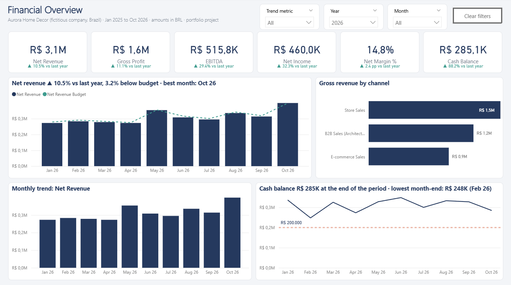
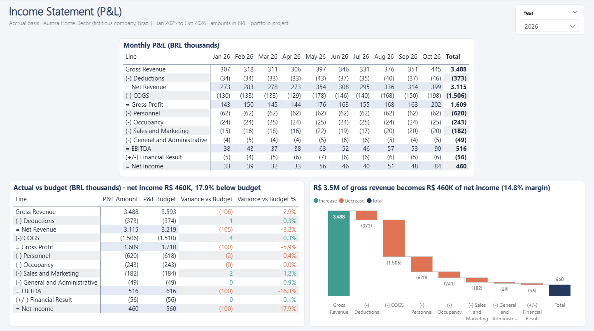
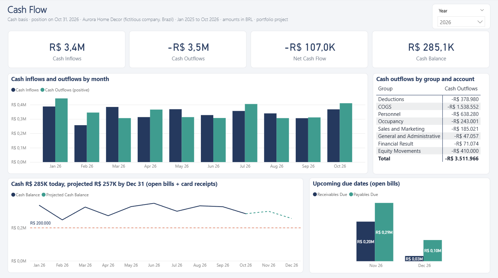
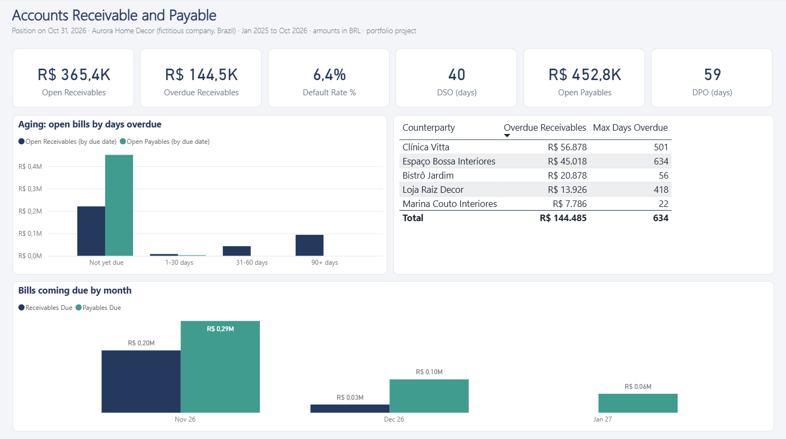
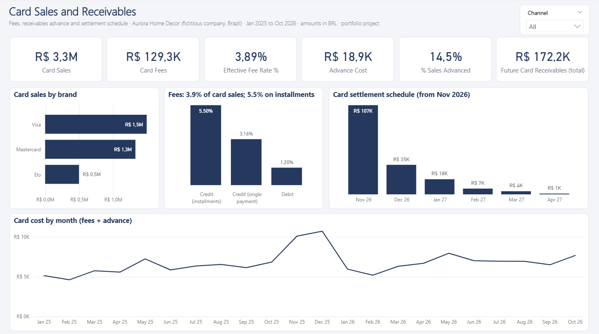

# Financial Dashboard for a Small Business (Power BI)

> Status: complete · Portfolio project with fictitious data

## Business problem
Small retailers usually run finance on ERP exports and spreadsheets: the owner sees the bank balance,
but not the margin by month, how much is overdue, what the card fees really cost, or how cash will look
next month. This dashboard puts the income statement, cash flow, receivables/payables and card sales in
one Power BI report that answers those questions.

The company is **Aurora Home Decor**, a made-up home decor retailer in Brazil with a physical store, an
online store and B2B sales to architects. Amounts are in BRL. Period: Jan 2025 to Oct 2026, snapshot on
Oct 31, 2026.



## Report pages
| Page | Questions it answers |
|---|---|
| Overview | Revenue, EBITDA, net income, margin and cash balance by month; revenue mix by channel; where operating expenses go |
| Income Statement (P&L) | Monthly P&L (accrual basis) and actual vs budget per line, with % of net revenue |
| Cash Flow | Inflows and outflows (cash basis), month-end cash balance and projected balance from open bills and card receivables |
| Receivables and Payables | Open AR/AP, aging buckets, default rate, DSO/DPO and the customers with the oldest overdue bills |
| Card Sales | Card fees and effective rate by payment type, cost of receivables advance, settlement schedule of future card receipts |

| | |
|---|---|
|  |  |
|  |  |

## Data model
Star schema with 4 fact tables and 4 dimensions, built from CSV files.

| Table | Grain | Notes |
|---|---|---|
| FactLedger | One line per financial event (44k rows) | Two dates: `AccrualDate` (P&L, active relationship) and `CashDate` (cash flow, inactive relationship used with `USERELATIONSHIP`) |
| FactBills | One receivable or payable (758 rows) | Due date, payment date, status and aging bucket at the snapshot date |
| FactCardSales | Sales per day, channel, card brand, payment type and installments (9k rows) | Fee rate, advance cost and settlement dates |
| FactBudget | Month x account | Budget for the actual vs budget page |
| DimDate, DimAccount | | Calendar (marked as date table) and chart of accounts grouped into P&L groups |
| DimPnLLine | 12 P&L lines | Disconnected table: one `SWITCH` measure computes each line from the account groups, so subtotals (Net Revenue, Gross Profit, EBITDA, Net Income) show as rows |

About 80 DAX measures in display folders (P&L, Budget, Cash, AR & AP, Cards, KPI vs LY, Titles), plus:

- **Calculation group `Time Intelligence`** (Current, PY, YoY, YoY %, YTD): prior-year logic written once and reused by
  every KPI; PY compares the same months up to the snapshot date, so a partial year is compared fairly.
- **Field parameter `Metric Selector`**: the viewer picks which measure the trend chart shows.
- **Dynamic titles**: chart titles state the finding (e.g. "Net revenue ▲ 10.5% vs last year, 3.2% below budget").
- **Conditional formatting by measure**: P&L subtotal rows shaded, budget variances green/red, KPI arrows colored.

Examples:

```DAX
Cash Balance =
VAR snap = [Snapshot Date]
VAR periodStart = MIN(DimDate[Date])
VAR periodEnd = MIN(MAX(DimDate[Date]), snap)
RETURN IF(periodStart > snap, BLANK(),
    MAX(Parameters[OpeningCash]) + CALCULATE(SUM(FactLedger[Amount]),
        USERELATIONSHIP(FactLedger[CashDate], DimDate[Date]),
        REMOVEFILTERS(DimDate), FactLedger[CashDate] <= periodEnd))
```

```DAX
P&L Amount =
VAR o = SELECTEDVALUE(DimPnLLine[LineOrder])
RETURN SWITCH(o,
    1, CALCULATE([Amount], DimAccount[Group] IN {"Gross Revenue"}),
    3, CALCULATE([Amount], DimAccount[Group] IN {"Gross Revenue", "Deductions"}),
    ...)
```

## How the data was made
`scripts/generate_data.py` simulates the business with a fixed random seed: daily store and online sales
with weekday and seasonal patterns (Mother's Day, Black Friday, Christmas), Brazilian payment mix (Pix,
debit, credit in installments), card fees by type, receivables advance, B2B invoices with late payers,
suppliers paid in 30/60/90 days, payroll, rent and taxes, a budget per account and quarterly profit
distribution. Figures are plausible for a small retailer (about BRL 4 million revenue a year).

## Report features
- Waterfall from gross revenue to net income; P&L in BRL thousands with negatives in parentheses.
- Budget shown as a dashed line over actuals; projected cash as a dashed line, with a minimum-cash reference line.
- Drill-through: right-click a customer on *Receivables and Payables* to open *Customer Detail* with its bills.
- Report page tooltip: hover a month to see revenue, net income, margin and revenue by channel for that month.
- Synced year slicer across pages and a *Clear filters* button.

## How to run
1. `python scripts/generate_data.py` (pandas, numpy): writes the CSV files to `data/`.
2. Open `powerbi/FinancialDashboard.pbip` in Power BI Desktop and click **Refresh**. If the folder moved,
   update the `DataFolder` parameter (Transform data > Manage parameters).

The project is saved in the Power BI Project format: the semantic model in TMDL
(`FinancialDashboard.SemanticModel/definition`) and the report in PBIR (one JSON file per page and visual), so every
change is readable in a Git diff.

## Tools
Power BI (DAX, Power Query, star schema), Python (pandas, NumPy), Power BI Project format (PBIP, TMDL +
PBIR) so the model and report are plain text and versioned in Git.
